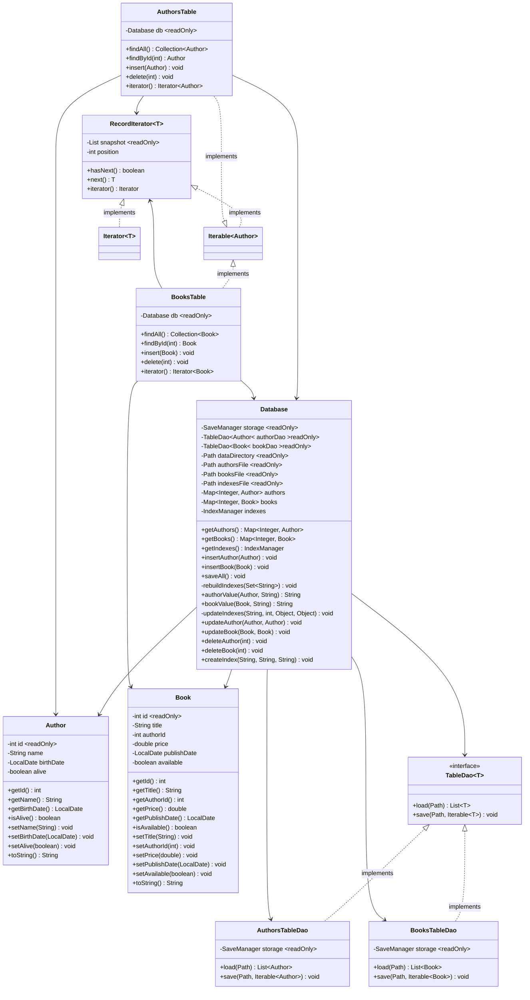
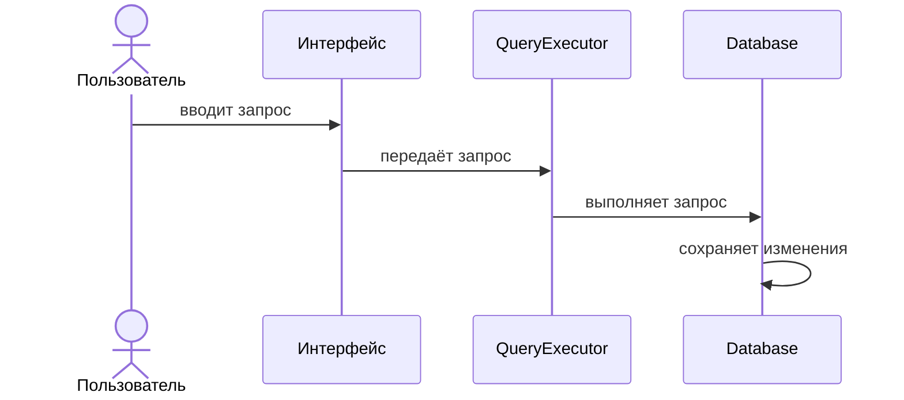

# LibraryDB — мини-СУБД на Java

## Запуск

- java -version

- cd путь/к/папке_с_проектом

- javac -d out library/Main.java 

- java -cp out library.Main


При запуске из корня проекта данные размещаются в `data/`.

## Архитектура

- `classes` - сущности `Author` и `Book`.
- `dao` - DAO-слой: `TableDao`, `AuthorsTableDao`, `BooksTableDao`.
- `SaveManager` - чтение и запись CSV.
- `tables` — таблицы авторов и книг, предоставляющие коллекции и итераторы.
- `RecordIterator<T>` - собственный итератор по снимку записей.
- `IndexManager` — хеш-индексы.
- `instrumentsForQuery` — разбор и выполнение SQL-подобных команд.
- `Main` - главный класс.
- `Database` — координация таблиц, проверка данных и сохранение.

## Схема данных

`Authors(id PK, name, birthDate, alive)`
`Books(id PK, title, authorId FK -> Authors.id, price, publishDate, available)`

## Хранение

- `data/authors.csv` — авторы.
- `data/books.csv` — книги.
- `data/indexes.csv` — список индексированных столбцов. При запуске сами хеш-индексы строятся заново по таблицам.

CSV-файлы UTF-8, строки с запятыми и кавычками заключаются в двойные кавычки. Не редактируйте файлы во время работы
программы.

## Поддерживаемые команды

```sql
INSERT INTO Authors VALUES (1, 'Лев Толстой', '1828-09-09', false);
INSERT INTO Books VALUES (1, 'Война и мир', 1, 1200.50, '1869-01-01', true);
SELECT * FROM Authors;
SELECT * FROM Books WHERE authorId = 1;
UPDATE Books SET price = 1500.0 WHERE id = 1;
DELETE FROM Books WHERE id = 1;
CREATE INDEX idx_books_author ON Books(authorId);
```

Поддерживается одна простая часть `WHERE` с операторами `=`, `!=`, `<>`, `>`, `<`, `>=`, `<=`. `SELECT` поддерживает
`*`; JOIN, AND/OR и агрегатные функции не реализованы.

## UML — основные зависимости



## UML — последовательность сохранения записи



# Список источников

- https://docs.oracle.com/javase/8/docs/api/overview-summary.html
- https://www.baeldung.com/get-started-with-java-series
- https://www.geeksforgeeks.org/java/java/
- https://habr.com/ru/articles/652867/
- https://javarush.com/groups/java-developer
